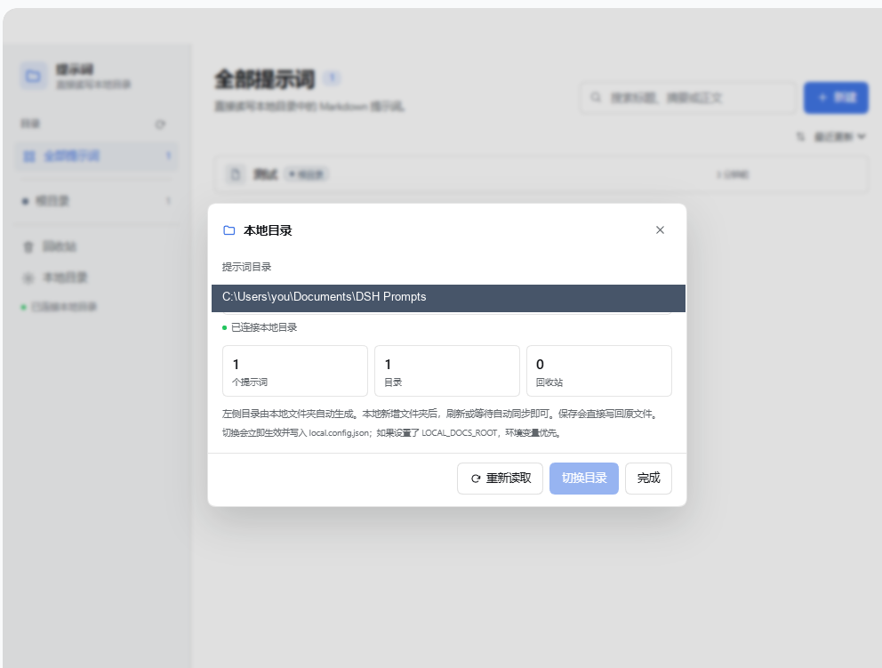
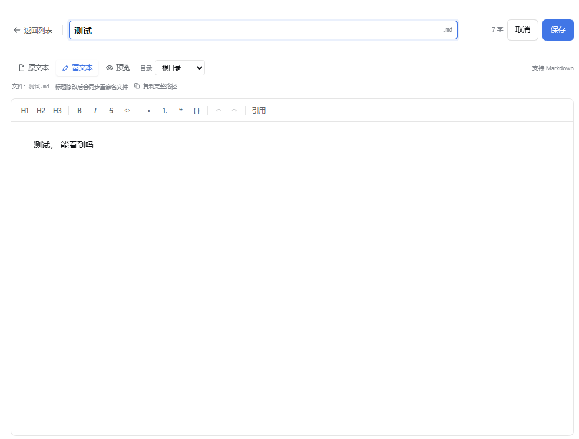
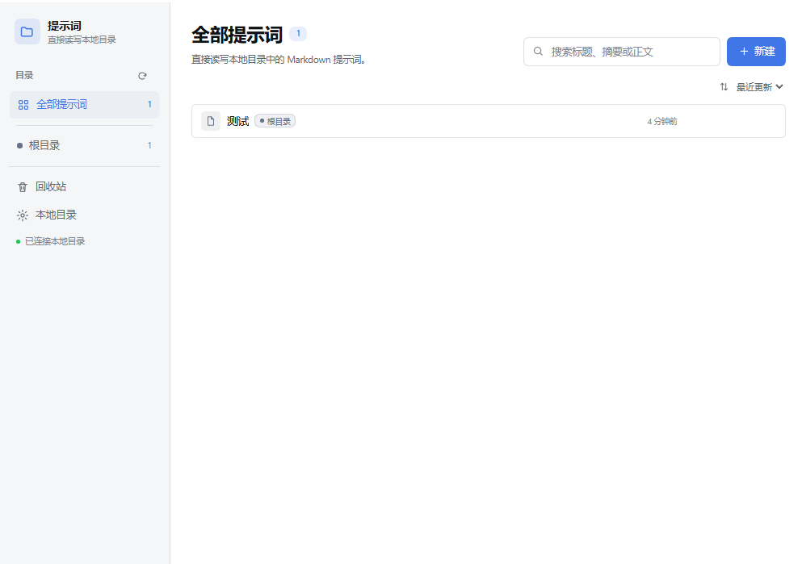
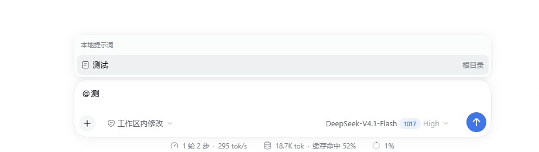
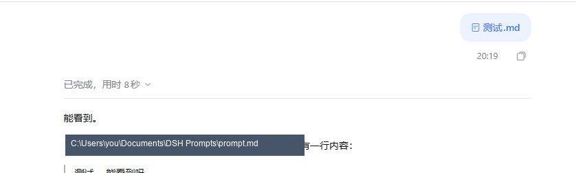

# Prompts — DSH plugin

Repository: https://github.com/bianshuhao/dsh-local-prompts

[中文](README.md)

A local Markdown prompt library inside DeepSeek Harness. Local folders become categories; each prompt is a `.md` file on disk.

## Screenshots

> Windows usernames and local paths in these screenshots have been redacted.

### Local folder



Current folder, connection state, counts, and an editable path with a Switch folder action.

### Rich text editor



Title is the filename; source / rich text / preview modes, references, images, and auto-save.

### Prompt list



Local folders on the left; search, sort, create, and open prompts on the right.

### @ mention in chat



Type `@`, then a Local prompts group appears; keep typing to search.

### The model reads a prompt



The selected prompt becomes an absolute-path mention that the model can read with its `read` tool.

## Install

This is a DSH bundle. Install the directory/repository through the DSH plugin manager, then **restart DeepSeek Harness**. Refreshing the page is not enough because the Host-side Node module must reload.

Package name: `@bianshuhao/dsh-local-prompts`.

## Default folder

```text
~/Documents/DSH Prompts
```

It is created automatically on first start. You can also edit the path in the Local folder dialog and click Switch folder; the change applies immediately and is written to `local.config.json`. Root priority:

1. `LOCAL_DOCS_ROOT` environment variable
2. `local.config.json` next to the plugin
3. default folder above

`local.config.json` example:

```json
{
  "root": "/absolute/path/to/your/prompts"
}
```

The file is git-ignored. Do not commit it.

## Features

- Folder tree on the left; create, rename, and delete empty folders; prompt list on the right; search/sort.
- Markdown source / rich text / preview modes; rich editing is serialized back to Markdown.
- Collapsible heading outline.
- Debounced auto-save after about 1.2s idle; manual Save remains.
- `@` mention source for prompts in the chat composer.
- Local images are copied into `assets/` and displayed through the local API.
- Trash, restore, purge, SSE sync, full local paths.

## Limitations

- Local API listens only on `127.0.0.1:45127`; fixed port.
- No authentication; do not expose the port publicly.
- A remote browser or SSH-forwarded DSH page cannot reach the user's `127.0.0.1`.
- Local image rendering depends on the local API; sharing a Markdown file alone does not copy images.
- Data is local; no cloud sync.

## Build (contributors)

```bash
npm install
npm run typecheck
npm run build
npm test
```

`client.js` is committed and ready to use; normal users do not need to build.
